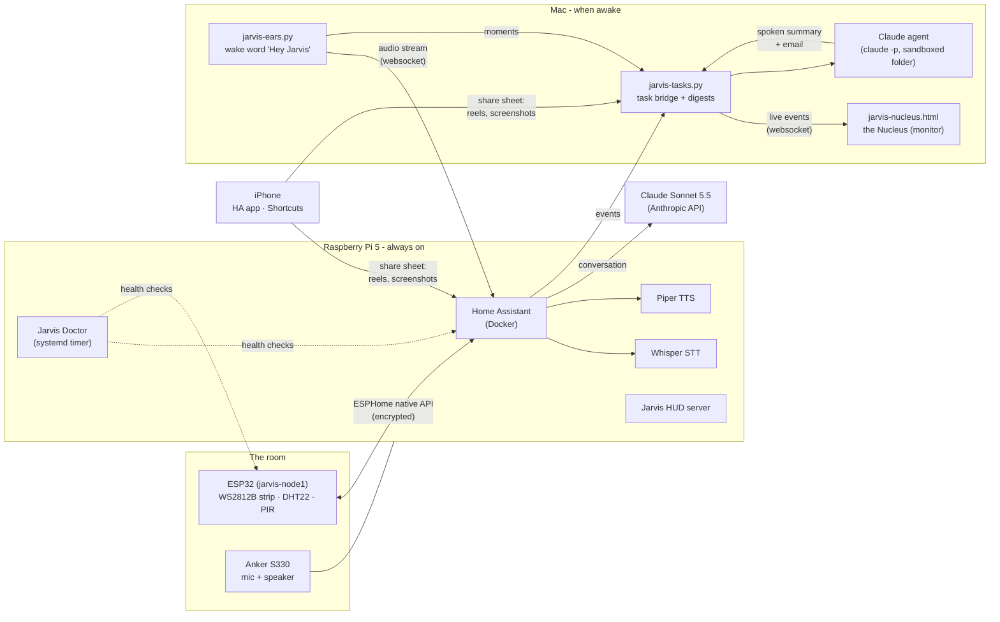

# Room Jarvis

A voice assistant for one room, built from scratch: an ESP32 runs the lights and sensors, a Raspberry Pi runs the brain (Home Assistant + local speech-to-text and text-to-speech), and a Claude agent on a Mac does real work when asked by voice — summarize the reels I saved, draft my recruiter outreach, run a task in a folder — and reports back out loud.

Started October 1, 2026 as a first hardware project. Everything here is running in my room today.

```
"Hey Jarvis, movie mode."            -> strip dims to violet, in under a second, no cloud
"Hey Jarvis, what's a tariff?"       -> Claude Sonnet answers in a British voice
"Hey Jarvis, task: reel digest."     -> 5 saved reels transcribed locally, insight digest emailed as a Word doc
"Hey Jarvis, task: recruiting digest" -> screenshots of job posts become tracker rows + outreach drafts in my voice
```

## How it fits together



Three tiers decide where a request goes, cheapest first:

| Tier | What | Where it runs | Cost |
|---|---|---|---|
| 0 | Lights, scenes, "what's the temperature" | Home Assistant on the Pi | free, ~0.5 s |
| 1 | Questions, conversation | Claude Sonnet 5.5 via HA's Anthropic integration | ~0.25 cent each |
| 2 | Tasks: "task: ..." | Claude agent on the Mac, in a sandboxed folder | 1-25 cents each |

## What's in the repo

| Path | What it is |
|---|---|
| `jarvis-node1.yaml` | The ESP32's program (ESPHome): strip, sensor, motion rule with night window and cooldowns, Jarvis light effects. Secrets come from an untracked `secrets.yaml`. |
| `jarvis-ears.py` | Wake-word listener. Streams the mic to Home Assistant's voice pipeline and plays the answer. Runs on the Mac now, moving to the Pi + S330. |
| `jarvis-tasks.py` | The task bridge. Listens for Home Assistant events, runs a Claude agent for voice tasks, and runs the reel digest and recruiting digest pipelines (transcribe → write → Word doc → email). Also hosts the phone photo drop, serves the Nucleus and streams live events to it. |
| `jarvis-nucleus.html` | The Nucleus: Jarvis's face on the monitor. A living core that reacts to the room's sound, shows what was heard and answered, turns into a progress ring while a task runs, and carries room telemetry, queues and clickable actions. Zero dependencies; `?demo=1` runs it standalone. |
| `jarvis-doctor.py` | Health checker on the Pi: board, containers, HA entities, disk, temperature. Restarts what it safely can, logs everything. |
| `jarvis-server.py` + `jarvis-hud.html` | The HUD: a sci-fi control screen for phone or monitor, with a PIN, served from the Pi. |
| `jarvis-study.py` | Pulls a bCourses class into a folder the agent can read. |
| `home-assistant/automations.yaml` | The six Home Assistant automations (voice modes, task bridge, reel catcher), as reference YAML. |
| `shortcuts/` | How the three iPhone shortcuts are built. |
| `scripts/` | One-command starts for the ears, the bridge, the Nucleus, a board flash, and a Doctor report. |
| `docs/` | [Architecture](docs/ARCHITECTURE.md) · [Runbook](docs/RUNBOOK.md) · [Changelog](docs/CHANGELOG.md) · [Learning notes](docs/learning/) on every layer. |

## Stack

ESP32 · ESPHome · WS2812B · DHT22 · PIR · Raspberry Pi 5 · Docker · Home Assistant · Wyoming protocol · faster-whisper · Piper · openWakeWord · Python (asyncio, websockets, sounddevice) · Claude Sonnet 5.5 · Claude Code (headless agent) · yt-dlp · python-docx · openpyxl · iOS Shortcuts

## Design rules I keep

- **Local first.** Lights, scenes, and voice recognition never leave the house. The cloud is only for thinking.
- **The agent is on a leash.** It can edit files only inside its own task folder, read the web, and nothing else. 15-minute limit per task, a monthly spend cap, every run logged.
- **No secrets in git.** WiFi, keys, tokens, and passwords live in untracked files; `.gitignore` names each one.
- **Draft, don't send.** The recruiting agent writes messages; I send them.
- **Account-safe.** No scraping Instagram or LinkedIn. Everything enters through the share sheet, one item at a time, by me.

## Status and roadmap

Phases A-G1 are done (body, brain, ears by phone and Mac). In progress: moving the ears to the Pi with the S330 (Phase G2). Next: a camera so Jarvis can answer "what am I looking at", a glowing ring that reacts when it listens, and the agent reachable from campus over Telegram. The full plan lives in a tickable checklist I keep updated as I build.

---
*Built by Adil Shivakumar with Claude as pair programmer. The nuances of each layer are written up in [docs/learning](docs/learning/) so I actually understand what I'm running.*
